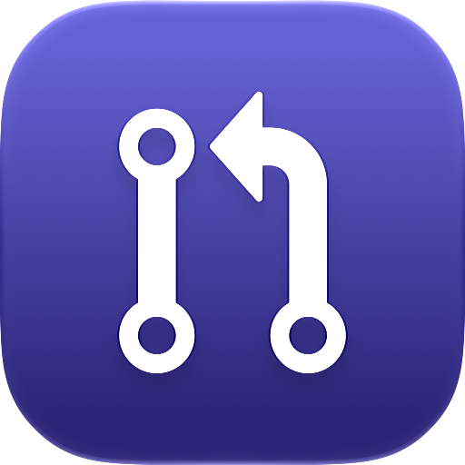
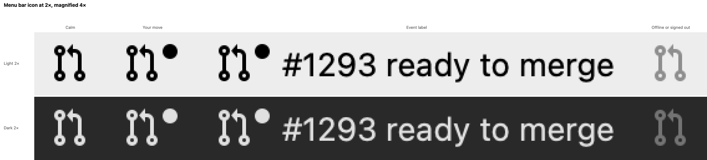

# GitHub PR Watch



A macOS menu bar app, with a full window, for people who shepherd a lot of GitHub pull requests.
Teammates and their coding agents open many PRs, CI takes 15 to 60 minutes, and auto-merge stalls.
GitHub PR Watch shows where each PR stands, as GitHub reports it, and tells you the moment one changes.

It is **read-only**. It shows PRs and sends native notifications. It never merges, re-runs, approves, or writes to GitHub. Clicking a PR opens it in the browser.

## How it works

- **Views are saved filters.** A view is a named rule tree: groups that match all, any, or none of their conditions, on author, assignee, review requested, repo, label, draft, CI state, merge state, lane, title, and base branch, each with "is", "is not" or "is any of". A user condition can name "me", "my teams" (for review requests) or a list of logins. The view editor builds these as rule rows with one level of nested groups, from templates: Blank, Mine, Needs my review, Watchlist, Agent PRs.
- **Each view has notification rules**: which events notify for PRs in that view.
- **Events are transitions** between two polls: CI finished (green and ready, green but blocked, failed with the failing checks, or green and still waiting), entered or dropped from the merge queue, approved, changes requested, review requested from you, and a new PR in the view (counted when it's ready for review, so a draft is silent until it leaves draft). The first poll after sign-in only sets a baseline. The last snapshot is saved, so a relaunch doesn't notify again.
- **The main window shows five lanes**, in pipeline order: CI running, Failing (a failed check, merge conflicts, behind base, a guard check such as required-commit, branch protection, or dropped from the merge queue), In review (waiting on a review, or changes requested), Ready to merge, and Merge queue. A lane is a fact GitHub reports, the same for everyone looking; who owns a PR is what views are for. Drafts sit in a collapsed Drafts group at the end of In review. The decision table, including which lane wins when a PR fits two, is in `PRStatus.swift`. A view picker chooses which PRs fill the lanes, and each view's tab counts its open PRs, drafts left out.
- **Each PR shows a symbol and a plain sentence**, never color alone, such as `2 checks failed: e2e-chrome, lint`, `CI passed · blocked by required-commit` or `Review requested from you`. The sentence always describes the lane the card is in.
- **Within a lane**, CI running is longest-running first, Merge queue is by queue position, and the others put a PR whose CI just finished first, then the most recently changed. A PR whose CI just finished is highlighted for 15 minutes in whichever lane it landed in, and CI running briefly notes where it went (`#4826 finished → Ready to merge`).
- **The menu bar item** is the app's pull request mark. A filled badge beside it means something changed since you last looked: it turns on with any event your views notify about (whether or not banners are on) and clears when you open the popover or bring the main window to the front. It starts clear at launch, and dims while offline or signed out. For about 8 seconds after an event it also names it, such as `#1293 ready to merge`. The popover lists Recent changes first (the PRs the badge was for, newest first, up to five), then every PR under the five lane names, each collapsible, with Failing and Ready to merge open to start.
- **Banners are calm.** A PR with several events in one poll gets one banner, for the most important. A poll that changes many PRs posts at most three banners, the last summing up the rest (`4 more pull requests changed`). A drop from the merge queue waits one poll and notifies only if the PR is still open and still out of the queue, since GitHub can drop the entry briefly while a merge lands. Settings has the master switch, sound, the menu bar label, and a quiet-while-in-front option.

The app is an accessory (menu bar) app. While the main window is open it becomes a regular app with a Dock icon and a place in Command-Tab, and goes back to the menu bar when the window closes. The window opens at launch only until setup is finished.

## Signing in

Setup is one screen: sign in, pick starter views, optionally turn on notifications, pick repos, and press Start Watching. Notification permission is asked only when you press "Turn On…".

| Method | Where the token lives |
|---|---|
| **Your GitHub CLI login** (offered first when `gh` is installed) | Nowhere in this app. It runs `gh auth token` each time it needs one, so `gh auth refresh` and `gh auth switch` keep working. `gh` is found on `PATH`, then in `/opt/homebrew/bin`, `/usr/local/bin` and `~/.local/bin`. |
| **Sign in with GitHub** (OAuth device flow) | The Keychain, service `dev.lubelski.GitHubPRWatch`. Hidden until an OAuth client ID is set in `OAuthConfig.clientID`. |
| **A pasted token** | The Keychain, same service. |

**Team review requests** need the `read:org` scope (or, for fine-grained tokens and GitHub Apps, the organization Members read permission). With it, a review requested from one of your teams counts as requested from you, on the card ("Review requested from you") and in rules that say "review requested is me or my teams". Without it the app counts requests to you by name only and the view editor says so. `gh auth refresh -s read:org` adds the scope to a GitHub CLI login. Team membership is read once per watched organization and cached for six hours.

The device flow is fully implemented but has no client ID yet. A GitHub App with read-only permissions (Pull requests, Checks, Commit statuses, Contents, Metadata) is preferable to an OAuth App, whose only way to read private repos is the `repo` scope, which also grants write access.

## Polling and the API budget

Each poll uses GitHub's GraphQL API in two steps, so big repos stay cheap:

1. A light query lists every open PR in each watched repo (50 per page): title, author, assignees, review requests (users and teams), latest reviews, labels, review decision, mergeability, merge state, auto-merge, merge queue entry with position and queue length, head commit, base branch, and times.
2. A heavier query fetches check detail (every check run and status context, with its status, conclusion, times, link, and whether it is required, plus the last merge-queue removal reason) only for PRs that might match a view, 15 PRs per query.

Polls run every 60 seconds. When less than a fifth of the hourly budget is left, polls spread out so the budget lasts until it resets. A rejected token (401), the primary rate limit, GitHub's secondary rate limit, and being offline are separate states with their own retry rules. A rejected token stops polling until you act.

A check whose name contains `required-commit` is treated as a guard: when it is the only failure, the PR shows as "CI passed · blocked" instead of "CI failed". The list of guard names is in `AppConfig.guardCheckPatterns`.

## Build

Runs on macOS 27 or later. Requires Xcode 27 (for the macOS 27 SDK and SwiftUI macros). `xcode-select` doesn't need to point at it; the scripts set `DEVELOPER_DIR`.

```sh
./scripts/bundle.sh       # builds build/GitHub PR Watch.app
./scripts/render.sh       # draws the UI with placeholder data to build/renders/*.png
DEVELOPER_DIR=/Applications/Xcode.app/Contents/Developer swift test
```

Run the app from the bundle that `bundle.sh` builds, not with `swift run`. `swift build` records the wrong SDK version in the binary, and macOS then runs the app in a compatibility mode. The comments in `scripts/bundle.sh` explain.

### Icons

The app icon is `Resources/AppIcon.icon`, an Icon Composer file that `bundle.sh` compiles into `Assets.car` and `AppIcon.icns`. Its artwork comes from `AppIconDrawing.swift` and `PullRequestMark.swift`, the same code that draws the menu bar icon and the onboarding header. After changing the drawing, redraw the artwork and the pictures in `docs/`:

```sh
./scripts/render-icon.sh
```

`docs/icon.png` is a picture of the compiled icon for this README. `docs/icon-appearances.png`, `docs/icon-sizes.png` and `docs/icon-candidates.png` show it in each appearance, at each size, and next to the designs it was chosen from. None of them is used by the build.

`docs/menubar-icon.png` shows the menu bar icon in each state on light and dark menu bars, and `docs/menubar-icon-1x.png` its pixels at 1× and 2×. After changing how it looks, redraw them:

```sh
./scripts/render-menubar-icon.sh
```



The mark is based on the [Octicons](https://github.com/primer/octicons) `git-pull-request` icon (MIT), redrawn in code.

Settings, views and the last snapshot live in `~/Library/Application Support/GitHub PR Watch/` as `config.json`, `views.json` and `snapshot.json`.

## Layout

- `Sources/GitHubPRWatchCore`: everything testable, no UI.
  - `Models.swift`: `PullRequest`, `CheckRun`, `Repo`, `Viewer`, and GitHub's enums.
  - `PRStatus.swift`: the classifier and the lanes. Its doc comment has the decision table.
  - `Filter.swift`: the rule tree, `SavedView`, `EventKind`, and the starter views.
  - `ViewDraft.swift`, `ViewTemplates.swift`: the editable form of a view for the rule builder, its validation, and the templates for new views.
  - `PRStore+Views.swift`: live preview, autocomplete values, and duplicating views.
  - `Transitions.swift`: the transition detector and the saved snapshot.
  - `NotificationWording.swift`: banner text for each event.
  - `NotificationPlanner.swift`, `QueueDropDebouncer.swift`, `NotificationSettings.swift`: which banners a poll becomes.
  - `MenuBarSummary.swift`: the menu bar icon's state and the popover's groups.
  - `ChangeBadge.swift`: the menu bar badge, "something changed since you last looked", and Recent changes.
  - `LaneBoard.swift`: what fills the lanes, their order, and the just-finished highlight.
  - `LegacyLaneMigration.swift`: loads views saved with the old lane names.
  - `PullRequestMark.swift`, `AppIconDrawing.swift`: the app's mark and the app icon's artwork.
  - `GitHubClient.swift`, `GitHubQueries.swift`: the GraphQL client and its documents.
  - `Auth.swift`, `DeviceFlow.swift`, `Secrets.swift`: the three sign-in paths and the Keychain.
  - `PRStore.swift`: the `@Observable` app model that the UI reads.
  - `SampleData.swift`: placeholder PRs and a static API for renders and tests.
- `Sources/GitHubPRWatchUI`: the SwiftUI views and `UserNotifier`. One file per feature.
- `Sources/GitHubPRWatch`: the `App` and its scenes, nothing else.
- `Sources/GitHubPRWatchRender`: the windowless render tool.
- `Tests/GitHubPRWatchCoreTests`: tests for Core.
